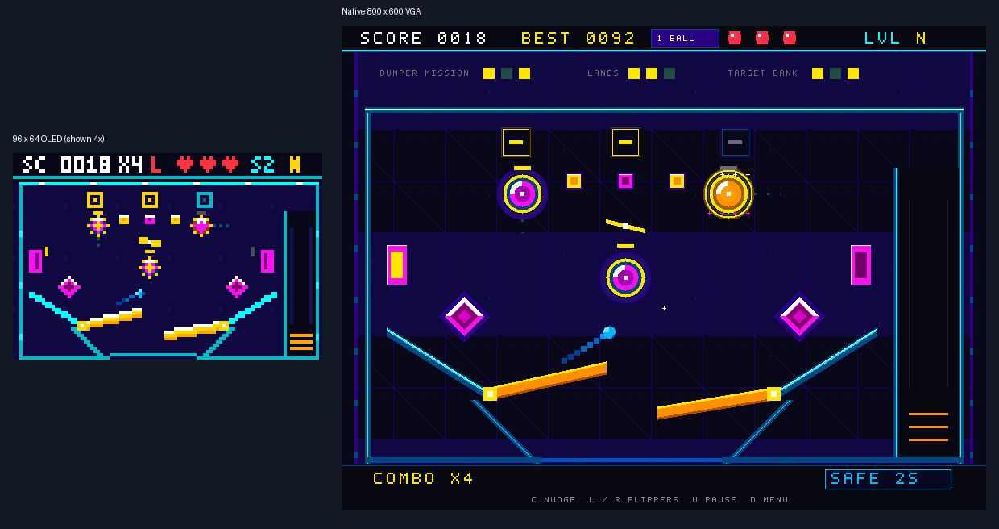

# EE2026 FPGA Pinball: Code, Concepts and Rebuilding Guide

A teaching guide to the finalized Basys 3 project. Written for someone who did not write the code and wants to understand it well enough to design another FPGA game.

**Design snapshot:** 14 October 2026, `xc7a35tcpg236-1`, Vivado 2025.2. Simultaneous 96 x 64 color OLED on JC and native 800 x 600 VGA. One/two-ball selection is in the menu; SW1 is ignored. The optional mouse uses SW0. The authoritative implementation evidence is `build/manifest.json` and `docs/VALIDATION.md`.

This document explains the actual RTL, then turns its design choices into reusable lessons. Small teaching snippets are marked as examples; they are not replacements for the complete modules. A section called "rebuild" describes a new implementation you can develop yourself, rather than instructions to paste this entire project into a new folder.

## How to read and use this guide

Start with the architecture and digital-design foundations before reading the arithmetic-heavy collision code. Then follow one action through the design: press Center, charge, release, move a ball, collide, score, and draw the next frame. That path reveals why the modules exist and which signals connect them.

On a second pass, open each named source file beside its explanation. All custom RTL lives in `FDP2026.srcs/sources_1/new/`. The top file contains three modules, so "eleven custom RTL files" means thirteen custom modules. The supplied Verilog OLED interface and two VHDL mouse files add three more modules. They are preserved byte-for-byte.

Use three levels of understanding. First, know what each module promises at its ports. Second, know when its registers change. Third, know how the combinational logic computes the next value. Understanding only the pictures or only the equations is insufficient: a correct FPGA system needs the right values on the right clock edges.

After each major topic, explain it aloud without referring to the source. For example: why does one button press create one menu event, while a held button continuously operates a flipper? Why do two balls share a collision circuit? Why does a graphics frame contain a copy of the game state? These questions test the design principles you will need in a new project.

The original proposal separates motion, collisions, graphics, and game/input. The final design follows that decomposition and adds OLED output, moving objects, two-ball play, reduced scoring, richer feedback, and original reaction graphics. Scheduling and member-allocation text in the proposal are historical context, not descriptions of a different current circuit.

## What the complete machine does

This project implements a pinball game as interconnected digital circuits. It does not run a C game loop on a processor. The FPGA stores positions, velocities, game state, score, timers and input history in registers. Arithmetic and comparison circuits continuously calculate candidate results. Clock edges decide when those candidates become the new state.

The table has three bumpers, two side targets, three pass-through rollover lanes, a spinner, two diamond slings, three stand-up targets, walls, guides, a shooter lane, and two flippers. Two bumpers move on short tracks. A game has three lives, with finite launch/target saves; the turn continues until all selected balls drain. Both displays show the same game, although they do not necessarily start their frames at the same instant.

Board controls cover all essential actions. The mouse is an additional input device. The VGA connector carries RGB and synchronization signals; an external active VGA-to-HDMI converter produces HDMI. The FPGA does not generate a native HDMI/TMDS signal in this project.



The OLED portion of this preview is enlarged for readability. The native VGA renderer computes its own fine pixels, text and shapes. A visual preview is evidence of renderer output, not proof that a physical converter or OLED has been tested.

### Hardware and current measured budget

| Item | Current design |
| --- | --- |
| FPGA target | Artix-7 `xc7a35tcpg236-1` on Basys 3 |
| Main clock | 100 MHz, 10 ns period |
| Physics enable | Nominal 240 updates/second, generated every 416,666 main clocks |
| OLED interface clock | 6.25 MHz through a global clock buffer |
| VGA pixel clock | 40 MHz from an MMCM and global buffer |
| OLED connector | JC, RGB565, 96 x 64 pixels |
| VGA active area | 800 x 600 pixels, RGB444 on board pins |
| Routed LUTs | 18,380 / 20,800 = 88.37% |
| Routed flip-flops/registers | 3,563 / 41,600 = 8.56% |
| DSP blocks | 54 / 90 = 60% |
| Block RAM tiles | 0 / 50 |
| Worst routed setup/hold slack | +0.380 ns / +0.052 ns |

These are different resource categories. "88.37% of logic gates" is an imprecise description: 88.37% is the measured LUT utilization. Low register utilization does not imply that another large arithmetic or graphics feature will fit. A LUT implements a small Boolean lookup table; a register remembers state; a DSP implements dedicated arithmetic; block RAM stores larger memories. A design can exhaust one category while leaving others available.

The hardware roles and USB-to-PS/2 mouse bridge are described in the [Digilent Basys 3 reference manual](https://digilent.com/reference/_media/basys3/basys3_rm.pdf). The exact counts and design timing above come from this project's routed reports, not a board marketing figure.

## The EE2026 knowledge behind the project

The local EE2026 Lab 4 manual introduces sequential circuits, clocks, counters, behavioural modelling and structural composition. The project manual adds OLED coordinates, RGB color, input handling, smooth movement, seven-segment multiplexing, and integration into one bitstream. Pinball combines these foundations into a larger system.

| EE2026 concept | Where to observe it | What to understand |
| --- | --- | --- |
| Boolean/dataflow logic | Renderer shape tests, input predicates, hit masks | A condition describes a combinational circuit |
| Structural modelling | `My_Top_Module` instances and port connections | Modules are hardware components connected by nets |
| Sequential circuits | Game state, input counters, physics registers | New state depends on previous state and current inputs |
| Binary counters | Tick counter, debounce counters, animation/timers | Width and terminal-count conditions determine behaviour |
| Clock division | OLED divider, MMCM pixel clock | Frequency division differs from a clock-enable pulse |
| Finite-state machines | MENU/READY/PLAY/PAUSE/OVER; driver startup | State determines legal transitions and operations |
| Multiplexers | Shared collision operands, selected font/glyph, scan digit | Selection shares hardware while requiring clear timing |
| Number representation | Signed Q8 motion; BCD score | The bit pattern and its interpretation must agree |
| Display interfacing | OLED SPI, VGA raster, seven-segment anodes | Pixels or digits require an interface protocol |
| System integration | Hit events, commands, scene snapshots | A common signal contract prevents module conflicts |
| Verification | Self-checking benches and rendered frames | Expectations must be checked, not merely observed |
| FPGA implementation | Synthesis, placement, routing, timing constraints | Correct simulation does not establish physical timing |

This is a learning map, not a promise of marks or a replacement for current assessment instructions. The game uses a 5 ms stable-sample input filter for responsiveness. The project manual's introductory exercise describes a different debounce strategy with a longer lockout window. Learn the shared principle—one physical press should create one event—without assuming the game's constants are the required values for every lab exercise.

The proposal's four functional components are visible here: physics calculates motion, collisions correct it, rules interpret contact events, and graphics displays the resulting state. Input processing and the top-level wiring connect those responsibilities. Being able to explain this separation is more useful than memorizing individual Verilog lines.

## Digital-design foundations before reading the source

### Combinational logic versus stored state

A combinational circuit produces an output from its current inputs without remembering previous values. An `assign` expression, comparison or fully assigned `always @*` block can describe such logic. In a renderer, the pixel at `(x,y)` is determined from the coordinates and the selected scene. No sequence of software drawing calls is required.

A clocked `always @(posedge clk)` block describes state updated at clock edges. `position_x`, `score_bcd`, `state`, debounce counts and timers are examples of remembered values. A `reg` declaration by itself does not guarantee a physical flip-flop: the assignment context determines whether synthesis infers combinational logic, a flip-flop, or accidentally a latch.

Teaching example, not a drop-in project module:

```verilog
// Combinational condition: a rectangle exists at these coordinates.
wire inside_box = x >= 10 && x < 20 && y >= 8 && y < 16;

// Sequential state: move only on a selected update edge.
always @(posedge clk) begin
    if (reset)
        object_x <= 7'd10;
    else if (step_enable)
        object_x <= object_x + 1'b1;
end
```

All module instances operate concurrently. A source file's ordering does not mean the FPGA finishes input processing, then runs rules, then runs graphics as separate software tasks. Nevertheless, register boundaries introduce cycle latency. One module may consume a command on the following clock because nonblocking assignments publish it after the current edge.

### Why assignment type matters

Clocked state in this project uses nonblocking assignments, `<=`. The right-hand sides use values from before the edge, and the left-hand sides update together. Combinational calculation uses blocking assignments, `=`, so a later expression in the block can use a temporary result computed earlier in that block.

Consider this teaching example:

```verilog
always @(posedge clk) begin
    a <= b;
    c <= a;
end
```

After an edge, `a` holds the old `b`, while `c` holds the old `a`. This is a two-register pipeline; `c` does not immediately receive the new `b`. The game's award pipeline and delayed mouse-event handling depend on this distinction.

Within one clocked block, multiple active nonblocking assignments to the same register are resolved by their procedural order: the last executed assignment wins. The game intentionally puts reset/new-game/drain and collection updates in particular places. Reordering code for appearance can change a simultaneous-event outcome.

In a combinational block, give every result a default before conditional overrides. If some path fails to assign a result, the result must retain its previous value, so synthesis may infer a latch. A latch can be useful in a deliberate design, but these custom combinational modules do not intend to infer one.

### Width, signedness and safe arithmetic

Hardware numbers have finite widths. Seven unsigned bits represent 0 through 127. Six unsigned bits represent 0 through 63. Sixteen signed bits represent -32,768 through 32,767. Truncating, adding or shifting a number can change its meaning if the result width is too small or an operand unexpectedly becomes unsigned.

Use explicit widths where the design depends on a range: `3'd2` for a state, `16'sd256` for a signed Q8 unit, and a wider sum when carry is possible. A concatenation such as `{1'b0,value}` is unsigned unless deliberately cast; `$signed(...)` appears around appropriate physics operands for this reason.

The debouncer illustrates why parameterization must include width. Its count has to reach `STABLE_CYCLES-1`. With `STABLE_CYCLES=1048577` (1,048,577 samples), the terminal value is 1,048,576. A fixed 20-bit counter cannot reach it, so the long-interval version never accepted a stable press. The final code uses `$clog2(STABLE_CYCLES)`, with a minimum of one bit, to size the counter for the positive configured interval.

Custom source files use `default_nettype none` and explicit net ports. This turns a misspelled signal into a compilation failure instead of silently creating a one-bit wire. The directive is restored to `wire` at each file's end so it does not impose new requirements on the supplied modules. It is a maintenance safeguard; it does not improve gameplay by itself.

## Architecture, ownership and the module connections


The diagram emphasizes data ownership. Rules own score, lives and game state. Physics owns physical ball state and flipper angles. Collision logic computes a correction from an isolated snapshot. Renderers consume display copies; they never change a ball's physical position. This prevents a visual effect from accidentally becoming a physical obstacle.

| File or module | Main responsibility | Important inputs | Important outputs |
| --- | --- | --- | --- |
| `My_Top_Module` | Clocks, resets, input routing, module wiring, scene capture | Clock, buttons, switches, mouse interface | JC, VGA, LEDs, seven-segment pins |
| `pinball_input` | Synchronize and debounce board buttons | Raw buttons, clock, reset | Held `down`, pulse `pressed` |
| `pinball_game` | States, charge, score, lives, missions, saves | Actions, `tick`, hits, final drain, lane status | State, `prepare`, `launch`, charge, HUD fields |
| `pinball_physics` | Q8 motion and one/two-ball scheduling | Commands, held flippers, difficulty, `tick` | Positions, angles, hits, visibility, final drain |
| `pinball_collision` | Combinational contact and response | Stable old/proposed positions and geometry | Corrected position/velocity, raw contacts |
| `pinball_effects` | Trails and two retained spark bursts | Actual hit position, selected trail ball, active/tick | Trail and particle coordinate/life arrays |
| `pinball_scene` | Unpack OLED's frame bundle | 318-bit scene, pixel coordinates | RGB565 OLED pixel |
| `pinball_renderer` | Compact OLED geometry and UI | Frame state and logical pixel | RGB565 pixel |
| `pinball_vga_scene` | Unpack VGA's frame bundle | 611-bit scene, native coordinates | RGB565 native pixel |
| `pinball_vga_renderer` | Native detail, HUD, font, effects | Frame state and native pixel | RGB565 pixel |
| `pinball_vga_clock` | Generate buffered 40 MHz | Main clock, reset | Pixel clock, MMCM lock |
| `pinball_vga` | Raster counters and RGB/sync output | Pixel clock, computed pixel | Pixel coordinates, RGB444, H/V sync |
| `pinball_sevenseg` | Active-low digit multiplexing | BCD score, main clock | `seg`, `an`, decimal point |
| `Oled_Display` | Supplied OLED startup and SPI | 6.25 MHz clock, pixel data, reset | Pixel requests and OLED pins |
| `MouseCtl` / `Ps2Interface` | Supplied mouse protocol stack | 100 MHz, PS/2 pins, initial settings | Position, buttons, complete-packet event |

`pinball_scene` and `pinball_vga_scene` are in `My_Top_Module.v`. The entity `MouseCtl` is in `Mouse_Control.vhd`. File names and instantiated module/entity names need not be identical; named ports are the integration contract.

### The central command and event contracts

| Signal | Meaning and timing contract |
| --- | --- |
| `tick` | One main-clock-cycle enable roughly every 4.167 ms; not a separate physics clock |
| `prepare` | One-cycle request to put selected balls in the shooter lane and cancel pending physics/effects |
| `launch` | One-cycle request to launch prepared balls using the stored `charge` |
| `active` | Rules are in PLAY; permits accepting a new physics update |
| `hit_events[13:0]` | A one-cycle scoring contact transaction after filtering/rearming |
| `hit_ball` | Identifies which ball produced the corresponding hit transaction |
| `drained` | Final live-ball drain; a partial two-ball drain does not spend a life |
| `balls_visible[1:0]` | Independent white/gold live/queued visibility bits |
| `in_lane` | True only when every live ball is still in its own launcher lane |
| `frame_begin` | Display-specific moment to capture a whole scene |

Follow a normal launch. The game is READY and observes a held launch control. Every fourth `tick` changes `charge`. When the control is released, rules assert `launch`, enter PLAY, and establish eligible launch protection. On the next main-clock edge physics consumes the command and assigns launch velocities. At a later physics tick it snapshots operands, computes contacts, and commits corrected state after its isolated calculation window. Hits then become score transactions and effects. A display next captures a producer bundle at its frame boundary and paints that state for the full frame.

Every arrow in this description has a contract. If a new module expects a held level but you send a one-cycle pulse, it may operate for just 10 ns. If it expects a pulse but you send a held level, it may repeat hundreds of millions of times. Write down the meaning, clock domain, units, validity and lifetime of each signal before wiring modules together.

## Clocks, resets, physical inputs and the mouse

### Three real clocks and one slow enable

The board supplies 100 MHz. The top's four-bit divider has a bit that toggles at 100 MHz / 16 = 6.25 MHz; a BUFG routes that OLED clock globally. An MMCM multiplies the main clock by 10 to a 1 GHz VCO, then divides by 25 to produce 40 MHz for VGA. Dedicated clock resources distribute actual clocks with controlled skew.

The physics counter reaches `PHYSICS_TICK_LAST = 416665` and resets. Counting from zero includes 416,666 main-clock edges per pulse. Thus the actual rate is `100000000 / 416666 = 240.000384... Hz`, conventionally described as 240 Hz. Most game counters act on `tick` while their registers remain clocked by 100 MHz.

Teaching example:

```verilog
// Preferred pattern for a slower operation in the existing clock domain.
always @(posedge clk) begin
    if (reset)
        timer <= 0;
    else if (tick && timer != 0)
        timer <= timer - 1'b1;
end
```

Using `always @(posedge tick)` would turn an enable pulse into another clock domain. It would require different clock routing, reset treatment and timing constraints. The clock-enable pattern keeps short-lived actions, rule pipelines and the collision scheduler in one main domain.

### Reset is part of the design, not just a testbench convenience

The top initializes a 32-bit all-ones shift register and shifts zeros through it after configuration. Its nonzero value keeps system reset asserted at startup. Switches pass through two synchronizer registers; synchronized SW15 also asserts reset. Reset clears score and high score, menu selection, commands, physics, effects and mouse configuration.

The VGA clock generator has a lock indication. If lock disappears, the VGA reset pipeline asserts asynchronously; after lock, the pipeline releases reset through pixel-clock edges. This allows video logic to restart coherently even when the pixel clock was temporarily unavailable. Do not treat an unlocked generated clock as a valid display clock.

### Synchronization, debounce and edge detection are different

A physical button can change near a clock edge and can bounce mechanically. Two synchronization registers reduce the chance that metastability propagates into game logic. They do not by themselves eliminate bounce. Each input's debounce count advances only while the synchronized sample disagrees with the accepted level. When the count reaches its configured terminal value, the accepted level changes once.

At 100 MHz, 500,000 samples correspond to 5 ms. The five channels have independent counters, so bounce on one button cannot delay another. `down` is a held level; `pressed` is a one-cycle rising event. Left/right flippers use held controls, while menu toggles and pause use events. A held U therefore toggles the ball mode once, not continuously.

### The mouse is a supplied interface plus a game adapter

The Basys 3's USB-A host connection is bridged to PS/2-style signals for the FPGA. The protected `MouseCtl` and `Ps2Interface` handle protocol communication. The game supplies four initial configuration requests: maximum X 95, maximum Y 63, initial X 48 and initial Y 32. They use logical OLED coordinates, so one control layout can serve both displays.

Mouse buttons and coordinates can update during different parts of a packet. The top delays `new_event` and stores previous complete-packet buttons and cursor coordinates. Held flipper/launch controls use those committed button levels. On the dispatch cycle, click hit-testing uses the final packet coordinates, avoiding a click based on the previous Y position.

Click detection compares the current complete-packet left button with the previous committed left button. SW0 gates mouse actions. The clickable rectangles are deliberately bounded: mode, difficulty, Start, Resume and Restart. A decorative title or empty margin is not an action. The mouse cursor and hover graphics use the same logical layout; different-looking buttons must still have matching control regions.

Board and mouse controls are combined with OR conditions for held actions. Changing input devices therefore does not require another physics engine. Nudge is a separate edge action, rejected in the shooter lane and limited by a 480-tick cooldown. A similar adapter pattern works for a joystick, keypad or another peripheral: translate its protocol into the game's existing held and event signals.
